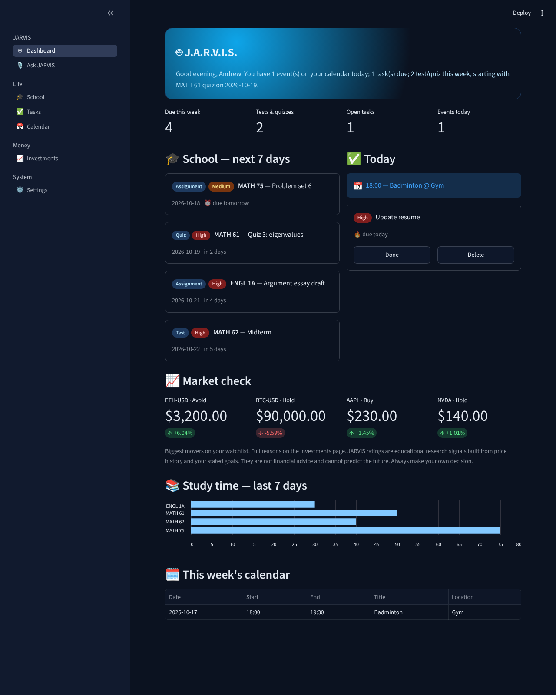
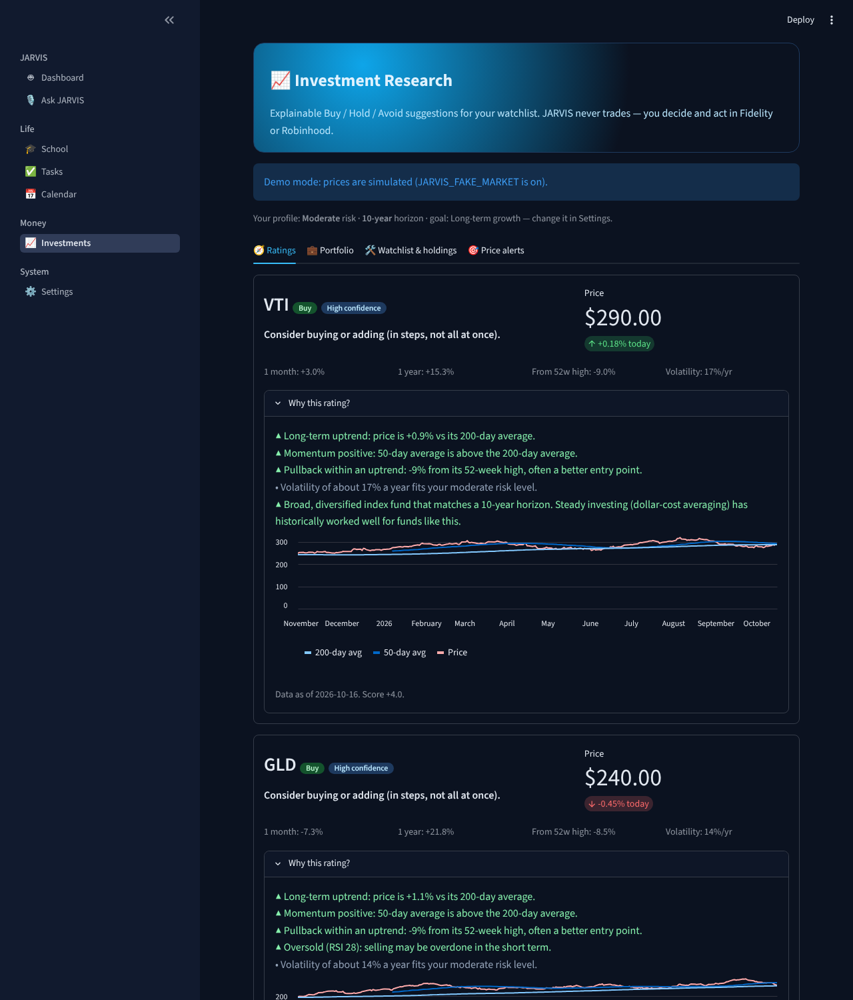
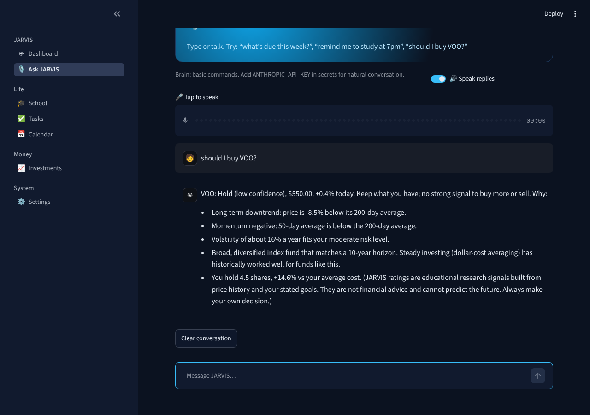
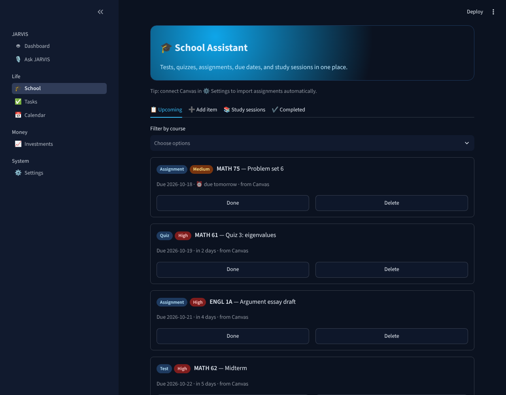
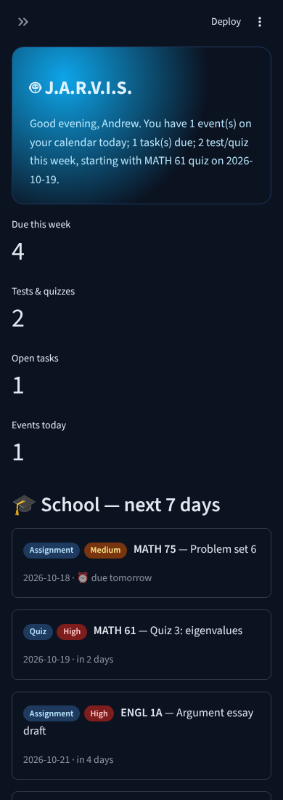

# 🤖 J.A.R.V.I.S. — Personal AI Assistant

A personal assistant inspired by JARVIS from *Iron Man*, built in Python. It runs my school life, my to-dos and calendar, and does explainable investment research. It talks back, and it pings my phone when something needs attention.



## ✨ Features

| Module | What it does |
|---|---|
| 🤖 **Dashboard** | Daily briefing ("Good evening, Andrew. You have 2 tasks due…"), the week's deadlines, today's agenda, market movers, study-time chart |
| 🎙️ **Ask JARVIS** | Chat by typing or **voice**. Speech-to-text in, spoken replies out. Powered by **Claude with tool use**: the AI calls functions to add tasks, quizzes, events and reminders, or to research assets. A rule-based fallback works with no API key |
| 🎓 **School** | Tests, quizzes, assignments and readings; study-session planning and logs; **Canvas LMS sync** (auto-classifies quizzes and exams, marks submitted work done) |
| ✅ **Tasks** · 📅 **Calendar** | To-dos sorted by due date and priority; events plus school deadlines on one timeline; reminders |
| 📈 **Investments** | Watchlist for stocks, ETFs, **VOO / S&P 500**, crypto and gold. **Explainable Buy / Hold / Avoid** ratings built from trend, momentum, pullbacks, RSI, volatility, and my risk tolerance and time horizon. Portfolio view across Fidelity and Robinhood (manual entry or Fidelity CSV import). **Suggestions only, never trades** |
| 🔔 **Alerts** | Scheduled monitor (GitHub Actions) sends **email and phone push** for big price moves, rating changes, price targets, work due tomorrow, upcoming tests, and reminders. Each alert is sent only once |
| 🔒 **Privacy** | Password lock; secrets kept out of git; no brokerage credentials ever stored |

<p float="left">
  
  
</p>
<p float="left">
  
  
</p>

## 🧱 Tech stack

**Python** · **Streamlit** (UI, works on phone and desktop) · **SQLAlchemy** with SQLite locally and **Supabase Postgres** in the cloud · **yfinance** (market data) · **pandas / NumPy** (indicators) · **Anthropic Claude API** (agentic tool use) · **SpeechRecognition + Web Speech API / gTTS** (voice) · **Canvas REST API** · **GitHub Actions** (CI with 60 tests, plus the scheduled monitor) · **ntfy + SMTP** (notifications)

## 🧠 How the ratings work

Every rating is a transparent sum of points, and each point appears as a plain-English reason:

- price vs the 200-day average (trend)
- 50-day vs 200-day average (momentum)
- a 5–20% pullback in an uptrend, or a 30%+ slump
- RSI below 30 or above 70
- annual volatility vs the comfort zone for my risk level
- a bonus for broad index funds over a 5+ year horizon
- a penalty when one holding exceeds 25% of the portfolio

Scores of 2 or more are rated Buy, −1.5 or less Avoid, and everything in between Hold. These are educational research signals, not financial advice. Details are in [GUIDE.md §9](GUIDE.md#9-how-the-buy--hold--avoid-ratings-work).

## 🚀 Run it locally

```bash
git clone https://github.com/Andrew-742001/jarvis-assistant.git
cd jarvis-assistant
python -m venv .venv && source .venv/bin/activate    # Windows: .venv\Scripts\activate
pip install -r requirements-dev.txt
streamlit run app.py
```

Add `JARVIS_FAKE_MARKET=1` to run with simulated prices. Run the tests with `pytest`. Optional services (Supabase, Canvas, Claude, Gmail, ntfy) are configured in `.streamlit/secrets.toml`; see `secrets.toml.example`.

**New to this?** **[GUIDE.md](GUIDE.md)** is a plain-English, step-by-step walkthrough of every file and setup step.

## 📁 Structure

```
app.py                     navigation
jarvis/
  db.py                    tables, CRUD, settings, briefing (SQLite ⇄ Postgres)
  canvas.py                Canvas LMS sync
  market.py                price data + symbol normalization
  signals.py               indicators → explainable ratings
  research.py              watchlist/holdings/portfolio, Fidelity CSV import
  assistant.py             Claude tool-use loop + rule-based fallback
  voice.py                 speech-to-text / text-to-speech
  alerts.py · monitor.py   notifications + scheduled checks
views/                     one Streamlit page per feature
tests/                     60 pytest tests (fake market + fake Canvas)
.github/workflows/         CI tests + scheduled monitor
```

## 🗺️ Roadmap

- [x] School + personal assistant, dashboard, reminders
- [x] Cloud database, Canvas sync
- [x] Investment watchlist, portfolio, explainable ratings
- [x] Email and phone alerts on a schedule
- [x] Voice + AI chat with tool use
- [ ] Fundamentals (P/E, earnings dates) and news sentiment in ratings
- [ ] Wake word ("Hey JARVIS") and hands-free mode
- [ ] Backtesting the rating rules on historical data

## 👤 Author

**Htet Aung Shinn (Andrew)** — Data Science & Math student, Evergreen Valley College
[Portfolio](https://andrew-742001.github.io) · [LinkedIn](https://linkedin.com/in/andrew-htet-aung-shinn-0899ab241) · [GitHub](https://github.com/Andrew-742001)
